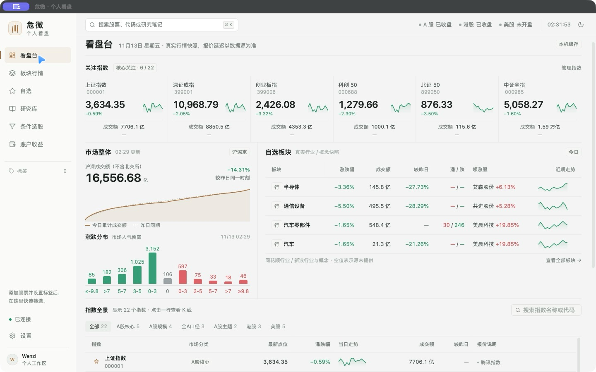

<div align="center">

# 危微 · Weiwei

**一个围绕你的看盘习惯、研究过程和量价关系打造的个人桌面终端。**

Tauri 2 · React · FastAPI · SQLite · 本机数据优先


</div>

## 看行情，也留下自己的思考

危微不是把尽可能多的指标塞进一个页面，而是把日常真正需要的信息组织在一起：

- 打开看盘台，先看指数、市场成交额、涨跌分布与关注板块。
- 看一只股票，直接读量价 K 线，同时进入自己的研究档案。
- 用真实财务指标和板块成分筛选证券，而不是在固定示例里挑选。
- 把研究正文、状态、态度、标签和复查日期持续沉淀下来。



> 截图来自实际桌面应用。行情使用真实数据源快照，可能延迟，不构成交易建议。

## 功能

| 场景 | 已实现 |
| --- | --- |
| 市场看盘 | 沪深京、港股、美股证券目录；核心指数、市场成交额、涨跌分布、行业与概念快照 |
| 量价图表 | 分钟、日、周、月 K 线；成交量、悬停涨跌幅、历史向前加载与完整已存历史 |
| 自选管理 | 竖排自选列表、多标签管理、按任一或全部标签筛选；新加入默认无标签 |
| 股票速览 | 搜索后点击名称打开独立详情；行情、财务资料与加入自选互不干扰 |
| 全市场选股 | 市场范围选择、数值/区间条件、真实行业与概念成分、可复用方案、CSV 导出 |
| 个人研究 | 全屏 Markdown 写作、预览/分屏、大纲、自动保存、历史版本、状态管理与永久删除 |
| AI 研究 | 自带 OpenAI 兼容服务；围绕当前研究正文对话，支持条件解析后人工确认 |
| 真实账户 | 现金、移动平均成本、持仓与收益曲线；多格式 CSV 导入导出、账户永久删除 |

不内置演示行情、示例账户或示例研究。板块历史优先使用官方来源；没有官方历史时，以真实成分股等权回溯并明确标注。

## 越用越快的本机数据底座

历史行情和选股数据不是每次点击后重新抓取，而是持续积累到你的 SQLite 数据库：

1. 优先读取本机历史与快照，页面先呈现结构，再更新具体数值。
2. 旧日线不重复下载；最新交易数据增量合并，周/月 K 线由本机聚合。
3. 全市场财务、分红和板块成分由后台限速采集，保存后供筛选重复使用。
4. 缺少数据时明确显示为空或未完成，不把缺失指标当成 `0`，也不伪造历史曲线。

`services/market-api/var/` 是运行期数据目录，包含个人研究、账户配置和行情数据库，**已被 Git 排除，不应上传或公开分享**。

## 快速开始

环境要求：Node.js 24+、pnpm 11+、Python 3.11+、Rust/Cargo。

```bash
git clone https://github.com/wenziq/weiwei.git
cd weiwei
pnpm install
pnpm setup:api
pnpm dev:desktop
```

`pnpm dev:desktop` 会启动 Tauri 客户端、FastAPI 服务和历史数据采集。

只需要浏览器开发环境时：

```bash
pnpm dev
```

打开 `http://127.0.0.1:5173`。API 文档位于 `http://127.0.0.1:8000/docs`。

### 前后端分离部署

在 **设置 → 连接与 AI** 中填写后端地址并测试连接，不需要重新打包。远程服务应使用 HTTPS，并通过 `WEIWEI_CORS_ORIGINS` 配置允许的前端来源。

AI 密钥由系统钥匙串保管；独立部署的服务端也可以使用 `WEIWEI_AI_API_KEY` 环境变量。密钥不会写入研究 JSON、浏览器 localStorage 或项目日志。

## 构建桌面安装包

```bash
pnpm build          # 类型合约与 React 生产构建
pnpm build:desktop  # Tauri 原生应用与 macOS DMG
```

当前已在 macOS Apple Silicon 上完成构建与原生操作验收。Windows 仍需构建和实机验证，手机端尚未开始。

DMG 不内嵌 FastAPI 服务；需要同时运行本机后端，或连接你部署的远程后端。当前安装包使用 ad-hoc 签名，公开分发前还需要 Developer ID 签名与 Apple 公证。

## 数据范围与诚实边界

- **行情与目录**：沪深京、港交所股票与 REIT、美股非 ETF 证券。
- **沪深京财务**：东方财富真实报告与近一年已实施分红，展示对应报告期。
- **行业与概念**：东方财富、同花顺、新浪真实分类与成分，后台分页采集并校验完整性。
- **港股、美股财务筛选**：尚无可靠的批量财务源，相关缺失值不参与数值比较，不使用预设样本补齐。
- **账户收益**：汇总收益、持仓成本与收益曲线仍为演示口径；账户配置和交易记录是真实持久化数据。

免费数据源可能延迟、限流或调整字段。请核对数据源的使用条款；本项目不代表已取得交易所实时行情授权、商业使用或再分发许可。

## 工程结构

```text
apps/desktop/                 # Tauri 2 客户端、React 页面与 Rust 原生配置
services/market-api/          # FastAPI、数据 Provider、采集服务与持久化
packages/contracts/           # 前后端共享 TypeScript 合约
scripts/                      # 开发进程与安装包构建
docs/prototype/               # 早期原型，仅用于设计参考
docs/images/                  # 实际产品截图
```

前后端通过 HTTP API 分离，共享字段契约；Provider、采集任务、业务服务与存储层分别组织，便于继续扩展数据源和桌面能力。

## 参与与反馈

欢迎提交 Issue 或 Pull Request，尤其是看盘场景、数据准确性、交互细节和跨平台兼容性。

请不要在 Issue、截图或附件中包含 API Key、证书、个人数据库、账户隐私或未公开的研究资料。安全问题请先移除敏感内容，再提供可复现步骤。

## 许可与免责声明

项目使用 [GPL-3.0 License](LICENSE)。第三方组件仍遵循各自许可；图表组件的来源与许可说明见 `apps/desktop/src-tauri/licenses/`。

危微仅用于个人行情观察和研究，不构成任何投资建议、收益承诺或交易依据。投资有风险，数据与 AI 输出都需要独立核实。
